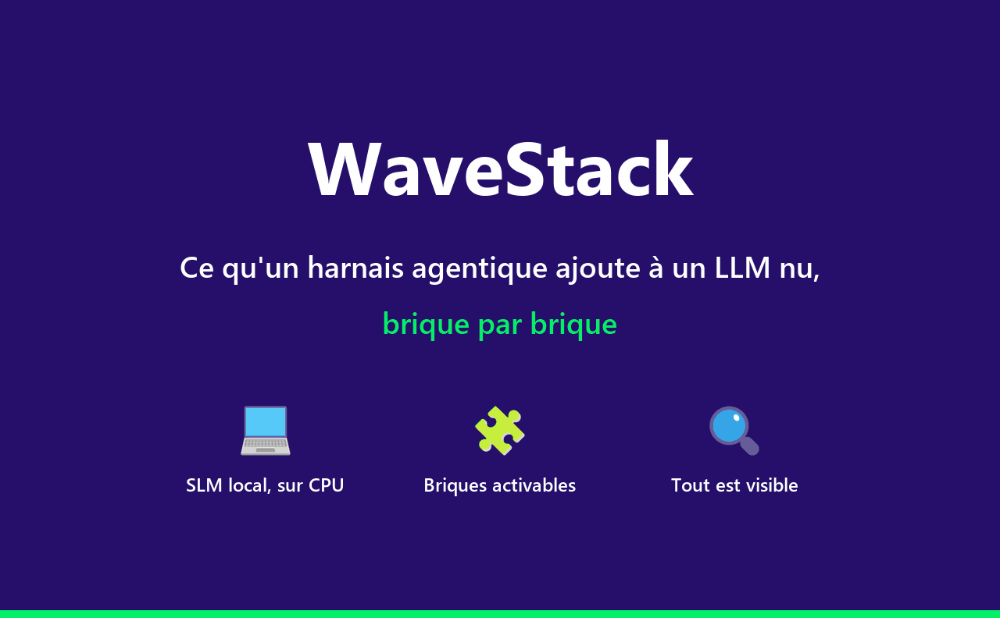

# WaveStack

WaveStack rend visible, brique par brique, ce qu'un harnais agentique ajoute à un LLM nu :
raisonnement, mémoire, prompt système, outils, RAG, MCP, skills, hooks, sous-agent et
compression du contexte. Démonstrateur pédagogique local, qui tourne sur CPU, sans GPU ;
interface en français, en anglais et en allemand.



*Même question, sans puis avec outils : le LLM nu avoue ne pas connaître l'heure ; avec les outils,
il appelle `get_datetime` et chaque étape s'affiche. Puis l'Atelier LLM, l'Atelier RAG et l'Atelier MCP. [Version vidéo (MP4)](docs/assets/wavestack-demo.mp4).*

## Comment ça marche

Un LLM seul ne fait que prolonger un texte. Le **harnais** est le programme qui l'entoure : à
chaque message, il assemble le contexte (prompt système, mémoire, descriptions d'outils,
extraits de documents…), appelle le modèle, exécute les outils que celui-ci demande et lui
en réinjecte les résultats, jusqu'à la réponse. WaveStack montre cette boucle pendant qu'elle tourne :

- **Des briques à allumer une à une**, au fil d'un programme guidé de six modules (5 h 15) :
  chaque scénario allume ses briques, donne sa consigne et propose ses prompts.
- **Quatre volets synchronisés** : ce que voit l'utilisateur, ce que lit vraiment le modèle (en
  tokens), ce que fait le harnais pas à pas, et où tourne chaque pièce (sur le poste ou non).
- **Trois ateliers pour regarder à l'intérieur** : l'Atelier LLM (texte, tokens, vecteurs,
  probabilités, token tiré), l'Atelier RAG (indexation puis requête, architectures toutes
  faites, modèle au choix par composant) et l'Atelier MCP (les messages JSON-RPC du protocole).
- **Un petit modèle local** (Qwen3.5-2B, 1,3 Go), sans droits administrateur, ou un modèle cloud.

## Installation sous Windows

Pour Windows 10 ou 11 x64, sans droits administrateur ; prévoyez 3 Go de disque (5,9 Go avec
tous les modèles du RAG) et 4 Go de RAM libre. Sous macOS ou Linux, ou si une étape bloque
(proxy, politique du poste), suivez [l'installation détaillée](docs/installation.md).

**Une seule commande**, dans PowerShell (pas CMD) : touche Windows, tapez `PowerShell`, Entrée, puis
collez la commande ([Ouvrir PowerShell](docs/installation.md#ouvrir-powershell)). Elle installe `uv` si besoin, récupère
WaveStack dans `Documents\WaveStack`, dépose le modèle Qwen (1,3 Go), puis lance l'appli ;
relancée plus tard, elle rouvre WaveStack sans rien retélécharger. **Sur un réseau
d'entreprise**, tapez d'abord `$env:UV_SYSTEM_CERTS = "1"` dans ce même terminal et faites
autoriser les domaines de [Derrière un proxy d'entreprise](docs/installation.md#derrière-un-proxy-dentreprise) :

```powershell
irm https://raw.githubusercontent.com/Aliquanto3/agentic-harness-training-demo/main/install.ps1 | iex
```

Depuis un clone ou un zip décompressé, double-cliquez plutôt sur `install.bat` : il installe sur place.

Au premier lancement, la page de diagnostic s'ouvre sans scanner tout le poste : seuls le
dossier des modèles, les chemins explicites et Ollama sont lus. Si plusieurs modèles sont
trouvés, cliquez sur « Choisir ce modèle » en face de Qwen3.5-2B, puis sur le lien « Harnais ».
Pour y ajouter des modèles déjà téléchargés ailleurs (cache Hugging Face, LM Studio), choisissez
« Ajouter d'autres modèles… », en bas du menu des modèles de l'Atelier Harnais.

**Si vous préférez les étapes à la main**, ou si l'installeur échoue : dans PowerShell (pas CMD),
installez `uv`, récupérez WaveStack, puis déposez le modèle Qwen (1,28 Go), hors du dossier cloné :

```powershell
powershell -ExecutionPolicy ByPass -c "irm https://astral.sh/uv/install.ps1 | iex"
git clone https://github.com/Aliquanto3/agentic-harness-training-demo.git
cd agentic-harness-training-demo
New-Item -ItemType Directory -Force "$env:LOCALAPPDATA\WaveStack\models" | Out-Null
$ProgressPreference = "SilentlyContinue"
Invoke-WebRequest -UseBasicParsing "https://huggingface.co/unsloth/Qwen3.5-2B-GGUF/resolve/main/Qwen3.5-2B-Q4_K_M.gguf" -OutFile "$env:LOCALAPPDATA\WaveStack\models\Qwen3.5-2B-Q4_K_M.gguf"
uv run wavestack
```

En cas d'échec du téléchargement, prenez [le fichier](https://huggingface.co/unsloth/Qwen3.5-2B-GGUF/resolve/main/Qwen3.5-2B-Q4_K_M.gguf)
avec le navigateur. Détails, extras et macOS/Linux : [installation détaillée](docs/installation.md#windows).

**Modèles du RAG.** Les modèles d'embedding et de reranking (121 à 639 Mo) se téléchargent depuis
l'interface : carte RAG de l'Atelier Harnais pour la brique RAG, bouton « Télécharger » de
l'Atelier RAG pour ses composants. [Détails et copie à la main](docs/installation.md#modèles-du-rag).

**Pour commencer**, choisissez le scénario « LLM nu » en bas à gauche et suivez sa consigne ;
le [programme de formation](docs/guide.md#programme-de-formation) enchaîne les modules. Ctrl+C
arrête WaveStack. Mise à jour : `git pull` (ou un nouveau zip), `uv sync` avec vos extras.

## Utiliser un modèle cloud (clé API)

Facultatif : le modèle local suffit pour toute la formation. Préréglages : Groq, Mistral,
Gemini, Gemma, Claude et GPT-6 Luna. Collez la clé du fournisseur au diagnostic, dans la ligne du
modèle (« Enregistrer la clé », prise en compte sans relancer), puis « Tester », « Choisir ce
modèle… » et « Utiliser ce modèle ». La clé reste sur ce poste, n'est jamais affichée ni tracée
et ne part que vers l'hôte du fournisseur. Plans gratuits, proxy et conditions : [Modèles cloud](docs/modeles.md#modèles-cloud).

## Aller plus loin

| Document | Contenu |
|---|---|
| [Installation détaillée](docs/installation.md) | Installeur, pas à pas manuel Windows/macOS/Linux, premier lancement, proxy, mise à jour, extras |
| [Guide d'utilisation](docs/guide.md) | L'interface, le programme de formation, les ateliers, le RAG, la compression, FinOps et GreenOps |
| [Modèles](docs/modeles.md) | Changer de modèle, fenêtre de contexte, Ollama et llama-server, modèles cloud |
| [Sécurité](docs/securite.md) | Page Sécurité, autorisations MCP, connexion GitHub, garde-fous, FinOps visible |
| [Contribuer](CONTRIBUTING.md) | Environnement de développement, conventions, tests, ajout de scénarios |

## Licence

WaveStack est distribué sous [licence Apache 2.0](LICENSE) : vous pouvez le réutiliser, le
modifier et l'intégrer à vos propres formations, à condition de conserver le fichier
[NOTICE](NOTICE) et de citer « WaveStack, par Anaël Yahi » avec un lien vers ce dépôt.
